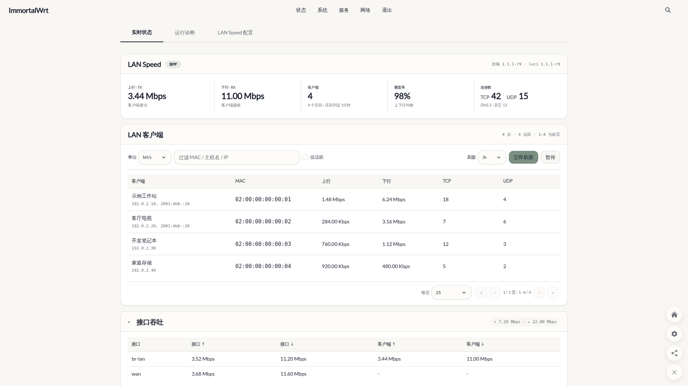

# luci-app-lanspeed

面向 ImmortalWrt / OpenWrt 的 LAN 客户端实时测速、连接查看与流量控制插件，由 Rust + Aya eBPF 守护进程（`lanspeedd`）与 LuCI 前端组成。当前版本：`1.2.1-r2`。

> 本仓库所有代码及文档（包括本 README）均由 AI 生成。



## 特性

- **实时速率与累计流量**：按客户端（MAC + 接口/VLAN）采集实时上下行速率与接入点，累计流量通过 SQLite 持久化。
- **活跃连接查看**：通过 Conntrack Netlink（不可用时回退 procfs）按远端 IP 聚合 TCP/UDP 连接；`x86_64` 支持补全 Mihomo / OpenClash 与 dae / daed 的逻辑代理连接。
- **每客户端限速与断网**：支持按客户端独立设置上下行限速及禁用上网；修改规则保持现有连接，仅管理自有 TC / IFB / nft 对象，不覆盖外部规则。
- **运行诊断**：内置 RPC、eBPF、ECM、接口拓扑与外部 QoS 冲突自检，支持导出脱敏排障报告。
- **多主题适配**：适配 Aurora、Argon、Bootstrap、shadcn 主题，支持桌面/移动端布局及亮暗模式。

## 平台支持

`x86_64` 与 Qualcomm `aarch64` NSS 采用独立编译路径与采集/控制实现，互不引用，也不做跨平台探测或回退。

| 目标平台 | 速率采集 | 客户端流量整形 | 说明 |
|---|---|---|---|
| `x86_64` | 原生 TC-BPF | HTB + FQ（上传经自有 IFB） | 不编译、不探测 NSS / ECM |
| Qualcomm `aarch64` (NSS) | Access Edge 总量 + ECM / TC-BPF 路径分类 | 单方向聚合 NSSHTB + NSSBFIFO（上传经 NSS IGS） | `TARGET_qualcommax` 默认启用，可在 menuconfig 关闭 |
| 32 位 ARM / i386 / MIPS | 不支持 | 不支持 | 仅支持 LP64 架构 |

采样窗口、ByteDomain 语义与平台隔离边界见 [平台与采集](docs/guide/platforms.md)。

## 安装与编译

### 预编译包

GitHub Release 只提供 x86_64 的 APK 与整合归档，不发布 Qualcomm NSS 预编译包。NSS 流量整形依赖专属 `kmod-lanspeed-nss-control`，必须与设备内核 ABI、NSS 驱动及固件编译配置一致，建议使用目标固件的同版源码或 SDK 自行编译，切勿混用其他固件产出的 kmod。

### 源码编译

在 ImmortalWrt / OpenWrt 源码根目录添加 feed 并编译：

```sh
echo "src-git lanspeed https://github.com/qimaoww/luci-app-lanspeed.git" >> feeds.conf
./scripts/feeds update lanspeed
./scripts/feeds install -a -p lanspeed

# 选择 LuCI -> Applications -> luci-app-lanspeed（自动选中 lanspeedd 与 lanspeedd-bpf）
make menuconfig

make -j"$(nproc)" package/lanspeedd/compile
make -j"$(nproc)" package/luci-app-lanspeed/compile
```

- **NSS 编译开关**：`TARGET_qualcommax` 在 `luci-app-lanspeed` 子菜单下默认启用 `CONFIG_LUCI_APP_LANSPEED_NSS`；关闭后回退至通用 TC-BPF 与 HTB + FQ 路径。
- **Rust Host LLVM 404 回退**：非 SDK 源码树编译 `rust/host` 若遇 `ci-artifacts.rust-lang.org` 预编译产物失效，可通过 `BASH="$PWD/feeds/lanspeed/scripts/rust-configure-wrapper.sh"` 改用本地裁剪构建。完整编译与 SDK 打包说明见 [构建与发布](docs/guide/development.md)。

## 包组成

| 包名 | 职责 |
|---|---|
| `lanspeedd` | Rust 守护进程，负责采集调度、UCI / ubus 接口与 SQLite 累计统计 |
| `lanspeedd-bpf` | 目标架构对应的 Aya TC-BPF 对象；启用 NSS 的 `aarch64` 构建额外包含 ECM kprobe 对象 |
| `luci-app-lanspeed` | LuCI 实时状态、连接详情、运行诊断与配置页面 |
| `kmod-lanspeed-nss-control` | Qualcomm NSS 专属内核模块（Generic Netlink / IGS / FastRate），须随目标固件编译 |

## 已知限制

- **Hardware Flow Offload**：开启后会绕过 x86 CPU TC hook，conntrack 无法补齐客户端总速率。
- **复杂拓扑覆盖**：WDS、Mesh、共享下联及未验证组播场景下覆盖率标记为 Partial；Wi-Fi 802.11 与以太网计数口径不一致时保留 `domain_mismatch`。
- **外部规则共存**：不抢占或覆盖外部 qdisc、IFB 与 nft 对象；检测到归属冲突时拒绝下发并输出原因。
- **透明代理归属**：NSS 下透明代理新建的 WAN socket 已丢失原始客户端身份，限速统一在客户端接入侧聚合执行，不在 WAN 侧反推归属。

## 界面预览

| 主题 | 实时状态 | 运行诊断 | 配置 |
|---|---|---|---|
| Aurora | [桌面](docs/screenshots/lanspeed-overview-aurora-desktop.png) / [移动](docs/screenshots/lanspeed-overview-aurora-mobile.png) | [桌面](docs/screenshots/lanspeed-diagnostics-aurora-desktop.png) | [桌面](docs/screenshots/lanspeed-config-aurora-desktop.png) |
| Argon | [桌面](docs/screenshots/lanspeed-overview-argon-desktop.png) / [移动](docs/screenshots/lanspeed-overview-argon-mobile.png) | [桌面](docs/screenshots/lanspeed-diagnostics-argon-desktop.png) | [桌面](docs/screenshots/lanspeed-config-argon-desktop.png) |
| Bootstrap | [桌面](docs/screenshots/lanspeed-overview-bootstrap-desktop.png) / [移动](docs/screenshots/lanspeed-overview-bootstrap-mobile.png) | [桌面](docs/screenshots/lanspeed-diagnostics-bootstrap-desktop.png) | [桌面](docs/screenshots/lanspeed-config-bootstrap-desktop.png) |

*截图基于确定性合成数据（文档保留地址与本地管理 MAC）通过 Chromium 渲染，已清除 PNG 元数据。*

## 文档

- [使用指南](docs/guide/usage.md) — 界面功能、客户端限速控制、UCI 配置与 ubus 调试
- [平台与采集](docs/guide/platforms.md) — x86 / NSS 平台架构、Access Edge 语义与控制链路
- [部署与排障](docs/guide/operations.md) — 运行依赖、内核选项、可见性告警与故障排查
- [构建与发布](docs/guide/development.md) — SDK 构建脚本、项目结构、测试套件与发布流程

## 许可证

除目录或文件另有声明外，本仓库自有代码基于 [Apache License 2.0](LICENSE) 发布。`net/lanspeedd/rust/vendor/` 中的第三方依赖保留各自随附的许可证；eBPF 对象中的 `GPL` 标记仅用于满足 Linux 内核验证器要求。
